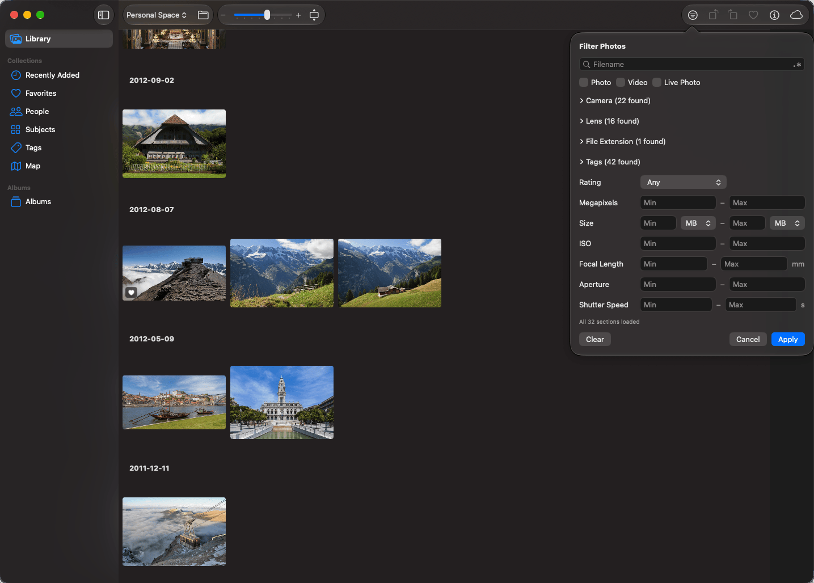
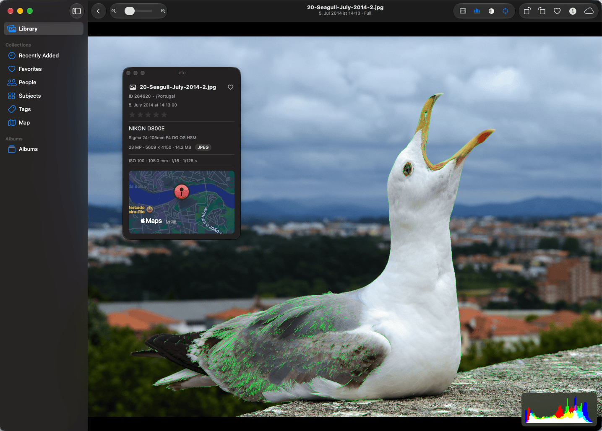
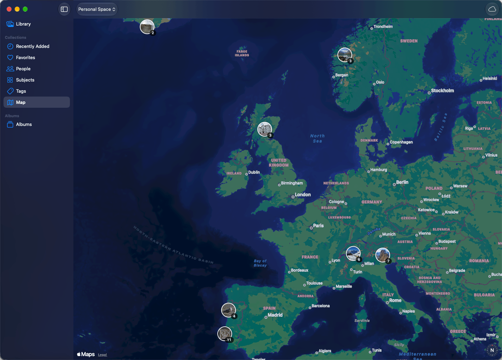

<h1>
  
  Cirrus Photos
</h1>

Cirrus Photos is a native Mac app for browsing your Synology Photos library on your own NAS. It is made for large libraries and keeps what it has already loaded on disk, so browsing stays quick on a slow connection and cached photos stay visible when the NAS is unreachable.

**Status:** alpha, version 0.1. Expect rough edges, and expect saved caches and preferences to be discarded between versions until 1.0.

<p>
  
</p>
<p>
  
  
</p>

<sub>Photos in the screenshots are from Wikimedia Commons; see [photo credits](website/assets/CREDITS.md).</sub>

## What it does

- Browse Personal Space and Shared Space as a day-grouped timeline, with a date navigator, selection, and a viewer with zoom, filmstrip, histogram and video playback.
- Browse Favorites, Recently Added, People, Subjects, Tags, folders and a map of geotagged photos.
- Filter cached metadata by filename, camera, lens, tags, rating, size and other criteria, also offline.
- Work with albums: create, rename, add and remove photos, pin them to the sidebar, and manage sharing with other NAS users or by public link.
- Favorite, rate, tag, rotate and delete photos; download originals; open a photo in another editor; drag photos out to Finder; drop files in to upload.
- Cache thumbnails, metadata, originals and viewed video ranges on disk, with a size limit you set and an option to pre-download thumbnails for a date range.

The full feature list and its limits are in [docs/PROJECT.md](docs/PROJECT.md).

## Requirements

- macOS 27 or later
- A Synology NAS running Synology Photos
- An account on that NAS (two-factor authentication is supported)

## Install

1. Download the latest release from [GitHub Releases](https://github.com/finia2NA/syno/releases/latest), open it and drag Cirrus Photos to Applications.
2. The app is signed but not notarized, so macOS blocks the first launch. Open it once, close the warning, then go to System Settings ▸ Privacy & Security and click **Open Anyway**. Alternatively, remove the quarantine flag in Terminal:

   ```sh
   xattr -dr com.apple.quarantine "/Applications/Cirrus Photos.app"
   ```

3. On first launch, enter your server address, username and password (and the six-digit code if your account uses two-factor authentication). A bare host name means `https://host:5001`; plain HTTP is not accepted.

More detail is on the [install page](https://cirrusphotos.richardhanss.de/install.html). Updates arrive through the built-in updater.

## Privacy

- Your credentials are kept in the macOS Keychain.
- The app talks only to your NAS, and checks this project's website for updates.
- There is no analytics or telemetry.

## Reporting bugs

Please open an [issue on GitHub](https://github.com/finia2NA/syno/issues). Logs from just before the problem help. The app logs under the subsystem `de.richardhanss.cirrus-photos`; this prints the last 15 minutes:

```sh
log show --last 15m --info --debug --predicate 'subsystem == "de.richardhanss.cirrus-photos"'
```

If the app crashed, include the newest `~/Library/Logs/DiagnosticReports/CirrusPhotos-*.ips`. Check the log for anything private before posting it. In the app, **Copy Details** in the Activity panel copies a failed operation's details with credentials and the NAS address removed.

## License

GPL-3.0, see [LICENSE](LICENSE).

Cirrus Photos is not affiliated with or endorsed by Synology Inc. Synology and Synology Photos are trademarks of Synology Inc.

---

# For developers

Cirrus Photos is a SwiftUI app built with Swift Package Manager. Building needs the macOS 27 SDK. You can also open `Package.swift` in Xcode.

## Build and run

```sh
make                       # build a debug app bundle and open it (same as bash scripts/run.sh)
make release               # optimized build, opened; use this when judging performance
bash scripts/run.sh --build-only   # build, assemble and sign the bundle without opening it
swift run CirrusPhotos     # run the executable directly from the terminal
make clean                 # remove build artifacts for a clean build
```

The bundle is created in the ignored `.build` directory. It is signed with `CODESIGN_IDENTITY` or the first Apple Development identity, falling back to ad-hoc; a stable identity keeps the app's Keychain access across rebuilds.

### Distribution build

```sh
bash scripts/run.sh --distribution
```

This builds the public release bundle at `.build/distribution/Cirrus Photos.app` and does not open it. It is optimized, ignores `.env`, stores its cache in `~/Library/Application Support/de.richardhanss.cirrus-photos/` and has no App Transport Security exception. Development builds keep their cache in the ignored `.cache/` directory of the checkout.

## Releasing

Releases are DMGs on GitHub Releases; installed apps find them through Sparkle's appcast at `website/appcast.xml`, served from the website. Development builds never update themselves.

One-time setup:

- The EdDSA private key that signs updates is `secrets/sparkle_ed25519_private.key` in the main checkout (gitignored; also in the login Keychain under the Sparkle account `cirrus-photos`). Back it up: without it, installed apps reject every future update. Its public key is in `scripts/sparkle.env`.
- An Apple Development signing identity (or `CODESIGN_IDENTITY`), the GitHub CLI signed in (`gh auth login`) and SSH access to the web server (`ssh ionos`).

For each release, bump `BUILD_NUMBER` in `scripts/version.env` (and `MARKETING_VERSION` when the version changes), add a `## <version>` section to `CHANGELOG.md` and commit. Then:

```sh
make dmg            # tests, distribution build, checks, DMG and appcast item in .build/releases/; publishes nothing
make publish        # make dmg, then tags v<version>, creates the GitHub pre-release, adds the item to
                    # website/appcast.xml, commits it and runs make deploy-site
make deploy-site    # rsync website/ to the server
```

`make dmg ALLOW_DIRTY=1` allows an unclean tree for testing; `DRY_RUN=1` makes `publish` and `deploy-site` print what they would do. `publish` works from the current branch, pushes the tag (GitHub needs it for the release) and asks you to push the appcast commit. `DEPLOY_HOST`, `DEPLOY_PATH`, `SITE_URL` and `GITHUB_REPO` are Makefile variables you can override.

## Signing in during development

Without a `.env` file the app shows its own sign-in window, like the released app. For development you can instead create an ignored `.env` in the repository root; it takes precedence in development builds. Copy [.env.example](.env.example) and fill in `NAS_URL`, `USER` and `PW`, plus `OTP` (the TOTP secret) if the account uses two-factor authentication. Never commit `.env`.

`make switch-user TARGET=real|test|none` switches the development account while the app is quit:

- `real` and `test` activate `.env.real` or `.env.test`, each with its own cache (`.cache.real`, `.cache.test`).
- `none` removes `.env` so the app shows its own sign-in. It starts with a fresh cache, which is deleted when you switch away from `none`.

Use the disposable `phototest` account (`TARGET=test`) for anything risky such as writes or deletes. Accounts signed in from the app stay in the Keychain until signed out.

## Debugging and profiling

```sh
make debug      # build, open Console, and run the app in the foreground (Control-C stops it)
make profile    # optimized build, recorded under Instruments for 40 seconds
```

In Console, filter by `subsystem:de.richardhanss.cirrus-photos`. For video playback the useful categories are `viewer.video`, `repository.video` and `transport.video` (AVPlayer state, cache and range assembly, and NAS request status and timing). Logs exclude filenames, cache keys, credentials, session data, authenticated URLs and response bodies.

`make profile` writes the trace to `.build/profiles/` and opens it. Control-C stops it early and still saves. Options:

```sh
make profile PROFILE_SECONDS=20 PROFILE_TEMPLATE="Animation Hitches"
```

Animation Hitches traces are very large (about 20 GB per 60 seconds), so keep those short. Browser signposts (category `performance.browser`) mark layout passes, row creation and thumbnail cache reads and decodes, and show up in Instruments' os_signpost and Points of Interest lanes.

## Tests

```sh
swift test
```

The helper scripts have Python tests in `scripts/` (`test_switch_user.py`, `test_synology_login.py`).

## Other commands

```sh
make cloc    # line counts by language and directory; needs `brew install cloc`
```

It counts Git-tracked files and excludes submodules.

## Documentation

- [docs/PROJECT.md](docs/PROJECT.md): what the app does and its scope
- [docs/ARCHITECTURE.md](docs/ARCHITECTURE.md): structure and invariants
- [docs/SYNOLOGY_PHOTOS_API.md](docs/SYNOLOGY_PHOTOS_API.md): the Synology Photos endpoints as observed, with [docs/capturefindings/](docs/capturefindings/) showing how they were established and [docs/decisions/](docs/decisions/) recording significant decisions
- [docs/SynologyPhotosAPI](docs/SynologyPhotosAPI): a vendored submodule of the community API documentation. If it is empty, run:

  ```sh
  git submodule update --init docs/SynologyPhotosAPI
  ```

[AGENTS.md](AGENTS.md) holds the project overview and the rules for coding agents working in this repository.
