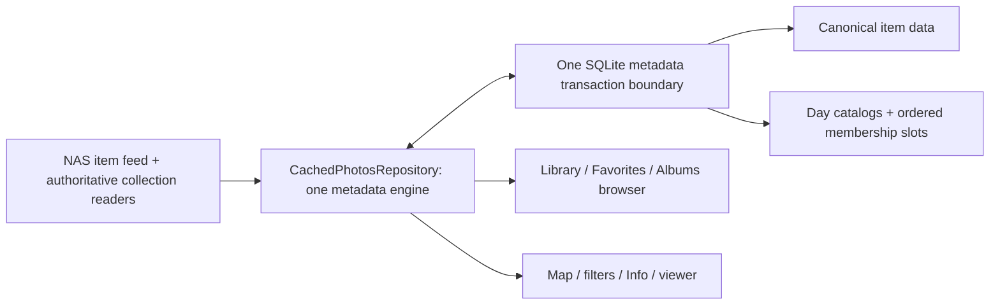

# Unified metadata engine and stable day pages

Status: **implementation draft, 2026-10-27; no product code implemented.** This
supersedes the earlier Map-first/independent-proof proposals. The user prioritizes
one clean architecture over shipping Map first. Library, Favorites, normal
Personal albums, Map and derived collections must use one repository-owned
metadata engine; they must not acquire independent Diff coordinators.

Current behavior remains documented in [PROJECT](../PROJECT.md) and
[ARCHITECTURE](../ARCHITECTURE.md). Protocol evidence is in
[Map/Diff results](../captures/MAP_DIFF_RESULTS_2026-10-26.md) and the
[Android capture](../captures/ANDROID_MAP_DIFF_CAPTURE_2026-10-26.md). The
[page topology investigation](../captures/TIMELINE_PAGING_ANALYSIS_2026-10-27.md)
is part of this plan and distinguishes observed NAS behavior from proposed
normalization.

## 1. Decisions and boundaries

Build one normalized metadata model and one coordinator inside the existing
`CachedPhotosRepository` actor:

- **Item identity:** one account/space/item ID, shared compact index and canonical
  full details. No whole `PhotoItem` copies stored in each collection page.
- **Collection identity:** predicates and authoritative membership/order, shared
  day counts and stable day-local page slots. Favorite/album membership is not
  inferred solely from ordinary item changes.
- **Change authority:** one engine owns source cursors, eligibility, invalidation,
  lookup, fences, fallback and atomic persistence. Collection providers acquire
  data; they do not call Diff or decide when to advance a cursor.
- **Map:** a projection of the same Personal item inventory, with a complete-
  inventory flag and its own presentation revision, not its own persisted cursor.
- **Sources:** start with proven v7 item `list`. Enable user/album event sources
  only if the small tests in section 10 establish semantics. Otherwise use
  authoritative collection reads **through the same engine**. Shared page schema
  does not mean all collections share the same freshness evidence.
- **Bounds:** terminal intervals only, at most 2,000 changed IDs and 4 MiB received
  Diff bytes; no modification pagination in this slice. Partial/large/ambiguous
  intervals invalidate affected scopes and use bounded authoritative recovery.
- **Product contract:** cached data is emitted before authentication/network
  waits. No periodic external-change polling. Normal reconciliation happens once
  per run; explicit refresh, known local writes and demanded-read consistency
  checks may require further engine work. Failed validation preserves cached data.
- Keep media byte caches, their HTTP validators, transfer lanes and rendition
  identities independent. Keep finite browser/viewer/filter retention bounds.
- No new metadata actor, generic plugin/strategy framework, arbitrary rule DSL,
  retained Diff-interval LRU, or per-view/per-collection synchronization engine.



## 2. Page geometry: what is true now and what changes

### Observed current layout

A `TimelineSection` has a day list, an offset **within its requested date range**,
and a limit. It is not a global collection offset. Library/Favorites sections may
pack several small days; a large day may repeat across sections with nonzero
within-range offsets. Existing captured examples include a 228-item day split
114/114, a 163-item section spanning nine days, and Favorites 344 items packed into
three sections spanning 69 days. Initial and full timeline packet boundaries can
differ. Albums currently synthesize one-day sections split at 1,000.

Do not implement assumptions that all NAS sections contain one day, every server
page has1,000 items, or a new day preserves server packet partitioning. No exact
new-day NAS repacking algorithm has been established, and this design does not
need one.

### Normalize every collection to stable logical day pages

Add `Sources/SynologyAPI/CollectionDayCatalog.swift`:

- `CaptureDay`: validated year/month/day, lexical identity and UTC arithmetic on
  **capture-local encoded wall time**, never Mac/GPS timezone inference.
- `CollectionDayCount(day:count:)`, with nonnegative counts.
- `CollectionDayCatalog(days:completeness:)`, sorted newest-first. For raw Personal/
  Favorites full timelines, deduplicate repeated days and require equal counts
  for repeats. Validate section coverage/count consistency before treating the
  result as full. Use checked arithmetic and existing scan/count caps before
  allocating sections/slots. Initial timeline is always provisional/partial.
- `DayPageAddress(collection:day:offset:capacity:order:)`; `capacity=250` is a
  single policy constant, offset is a multiple of250, and contains no section
  index, global ordinal, whole-timeline fingerprint or current day count.
- `CollectionDayPager.snapshot(catalog:capacity:) -> TimelineSnapshot`: every
  generated `TimelineSection` describes exactly one day, offset 0,250,... and
  limit`min(250,dayCount-offset)`. `TimelineDay.itemCount` remains the whole-day
  count on every split section. Preserve `LibraryIndex`'s existing ordinal mapping.

A storage slot represents a capacity 250 day slice. Its row records the catalog/
page membership version and actual count used when read; it cannot be reused
merely because its address stayed equal. The final short slot's size changing
must invalidate its membership, not silently extend an old array.

Keep catalog **presentation revision** separate from each day's membership
generation. Adding a different day changes the catalog/ordinal revision, but must
not make every existing slot stale merely because its catalog revision is older.
Persistent slot eligibility compares collection predicate/order, that day's count/
membership generation and applicable source-reset epoch. A whole-timeline
fingerprint or section-array revision is never its cache-validity stamp.

Use the same pager for Personal, Favorites, albums and session-derived
collections. Refactor `DayGroupedTimelineBuilder` to call it rather than keep a
second sectioning algorithm. Raw NAS section packing remains a transport input,
not persistent browser cache identity.

### Required shift behavior

| Action | Catalog/browser effect | Cache effect |
| --- | --- | --- |
| Add a new newest day | Prepend that day's sections; old ordinals/section indices move | Existing older day addresses remain valid if their membership evidence is unchanged |
| Add a missing middle/oldest day | Insert/append its sections | Same rule; invalidate only the new day plus genuinely affected collection dependencies |
| Add/delete within an existing day | Its count/tail limit/page count changes | Conservatively invalidate **all that day's membership slots**, not only the slot containing a known ID |
| Day grows 1,500→1,501 | Six capacity 250 slots become seven | Older day keys stay unchanged; all six old slots in the changed day require membership validation |
| Delete the last item of a day | Remove that day from the catalog | Remove/retire its slots; restore navigation to surviving item/day anchors |
| Capture-time edit across days | Update both counts/catalog positions | Invalidate both old and new day memberships; keep unrelated days reusable |
| Item edit with unchanged time | Item content changes; ordering may still be uncertain | Update canonical details and conservatively invalidate its day membership unless a tested mutation contract establishes order preservation |
| Unknown deletion/date origin | Cannot locate affected ranges safely | Invalidate the relevant collection scope; never infer that uncached IDs are irrelevant |
| Same-day delete/add preserving count | Catalog count may stay equal | Still invalidate membership; equal counts/fingerprints are not freshness evidence |

Rebase in-memory page windows by `DayPageAddress` when normalized snapshot indices
move. Never relabel an old numeric section index as a different day. Selection
ordinals must be remapped by known IDs or cleared, not allowed to select different
photos after an inserted day. Retain item/day-based scroll anchors and the
existing viewer-close/frozen-playlist behavior where applicable.

## 3. Logical pages and network batches are separate

Add `Sources/PhotoCache/MetadataReadPlanner.swift`, a pure bounded planner.
Inputs are demanded day addresses, current catalog/day versions, membership
coverage and required detail profile. Output is `CollectionReadBatch` with exact
predicate/sort/date bounds, offset/limit and expected per-day slices.

- Coalesce adjacent demanded small days when their bounds can be covered without
  unaccounted populated days. Maximum1,000 items and 32 populated days per demand
  batch. Do not pad a single visible demand to 1,000 merely to fill a batch.
- Coalesce contiguous offsets within a large day up to 1,000 items. Do not combine
  arbitrary nonzero offsets across different date ranges.
- Nonadjacent demands with intervening unrequested populated days are separate,
  unless all intervening work is explicitly admitted within the same bound.
- A catalog enumeration (e.g. a full album scan) may stream up to 1,000 entries per
  request across more days; it is a separate bounded enumeration operation and can
  seed many logical slots. No per-day network loop is required there either.
- At most two metadata requests are in flight across the engine, using the
  existing `NetworkGate` priorities. Share compatible overlapping jobs and
  promote visible demand; cancel/release subscribers using current bounds.
- After a response, demultiplex by capture day while preserving server order.
  Require expected day counts/offset coverage for each slot being marked current.
  Unexpected days, duplicate IDs, missing rows or inconsistent counts trigger a
  bounded catalog/membership retry; do not discard extra IDs to fit old geometry.
- Cold reads request normal full page fields and seed membership **and** canonical
  details in one request. If a dirty prior slot's known detail rows are current,
  membership-only reads (`additional=[]`) may reuse them and fetch only newly
  encountered/missing IDs. If details are already stale/missing, use the combined
  read instead of imposing two round trips for the same cold page.
- Full-detail ID lookups are coalesced across consumers,100 IDs/batch, at most two
  requests in flight. The existing transport's larger supported maximum need
  not become the scheduler default.

Why this is required: the captured Personal catalog would have 2,245 logical
capacity 250 pages versus 494 NAS sections; Favorites 69 versus 3. One HTTP request
per logical day page would regress performance. A purely offline greedy batch
illustration groups these counts into 92 and 3 requests respectively, but this is
not a benchmark/promise and excludes demand shape, details and fences.

## 4. One store: canonical rows, membership, validity

Add `Sources/PhotoCache/MetadataStore.swift` as typed SQL helpers using the
**existing DiskCache SQLite connection/actor**, not a second database/actor.
Keep transactions synchronous inside that actor; never suspend while a SQL
transaction is open. Proposed current metadata tables:

| Table | Key and purpose |
| --- | --- |
| `metadata_state` | Current metadata format version; account/space namespace; engine revision/reset epoch; source cursors and recovery/coverage state |
| `item_index` | Item ID, capture time, optional current GPS/thumbnail projection and compact-profile validity; retains non-geotagged IDs too |
| `item_details` | Item ID, canonical `PhotoItem` payload, fixed field-profile/version, content/annotation validity, revision/cost/LRU |
| `collection_state` | Collection key/type, catalog completeness/revision, current-run verification and membership policy |
| `collection_days` | Collection+day, authoritative count, membership generation and order policy |
| `day_pages` | DayPageAddress, ordered IDs/actual slot count, catalog/day generation, terminal/coverage flags and LRU |
| `page_items` | Indexed reverse references by item ID to stored membership slots; no duplicated detail JSON |

Use typed `CollectionKey` / Personal Space identity in every metadata key. Numeric
item IDs are not globally valid across accounts or spaces. Keep catalog counts,
materialized page membership and full item-detail coverage separate: knowing a
day has 5,000 items does not mean its IDs/details are cached.

### Metadata format and media preservation

Retain the base media `entries` table/schema if unchanged. Give normalized
metadata one current format version in `metadata_state`; initialize/reset these
new tables transactionally on missing/incompatible metadata version, and discard
superseded non-media metadata entries. Do **not** decode or translate old page
payloads, retain a dual read path, or add migrations. Current media records and
files can remain because their format is unchanged. Make remaining `CacheKind`
media values explicit if removing obsolete metadata cases would renumber them.
If implementation actually changes the base media schema, its existing full-
cache discard rule still applies; do not quietly invent a migration to avoid it.

Metadata-only reset clears all normalized tables/checkpoints/projections and
invalidates engine work through the existing lifecycle, preserving media. Full
clear removes both. Unknown format validation is required; historical-format
compatibility fixtures are not.

### Sparse item details and eviction

Normalize without losing useful offline data. Evicting one canonical detail row
must not shift all following page ordinals or hide 249 other cached items.

Add `Sources/PhotoCache/PhotoPageSnapshot.swift`:

```swift
public struct PhotoItemSlot: Sendable {
    public let itemID: Int64
    public let item: PhotoItem?       // detail payload may be absent after eviction
    public let verified: Bool        // includes required content/annotation authority
}
public struct PhotoPageSnapshot: Sendable {
    public let address: DayPageAddress
    public let membershipRevision: UInt64
    public let membershipVerified: Bool
    public let slots: [PhotoItemSlot] // exact ordered membership positions; never compacted
}
```

The schema is illustrative; implement concrete public/internal access as needed.
Define fixed profiles, not an arbitrary per-field graph: `identityAndTime`
(base fields only), `locations` (`gps`,`thumbnail` plus base fields), and
`fullPage` (the current `PhotosRequestFields.pageAdditional`). Track user
annotations' source/current-run authority separately even when returned in a full
page response. Only a profile which actually requested GPS may establish that
GPS is absent. An identity-only album scan must not remove a known pin or replace
full details with nil EXIF. A partial profile does not materialize a full-detail
slot as verified.

A known membership slot with missing details stays a placeholder at the same
position. Unknown page membership emits no invented IDs and uses the catalog's
placeholder geometry until fetched. The repository's page stream becomes
`ResourceEvent<PhotoPageSnapshot>`; replace consumers in one staged branch and
remove the superseded `[PhotoItem]` page API rather than retain a compatibility
wrapper. Aggregate event verification requires a complete current page; consumers
may use individual slot verification to authorize actions/downloads for present
current items. Missing/unverified selected items require authoritative resolution
or a clear unavailable result.

Charge detail bytes once, membership IDs/reference storage separately; include
both in metadata eviction/accounting. Detail eviction leaves compact inventory
and ordered membership intact. Membership eviction removes its reverse references;
it does not delete item rows used by other collections. Keep Map inventory high
retention as today. No dangling reference may silently shorten a result.

## 5. Engine state, source checkpoints and central change application

Add `Sources/PhotoCache/MetadataEngineState.swift` and
`CachedPhotosRepository+MetadataEngine.swift` (methods remain on the repository
actor). Replace overlapping job state in `RepositoryState.swift` with one engine
state containing:

- one coalesced reconciliation job per account/space;
- fixed supported source states (`items`, optionally proven `userEvents`/album
  events), each with its own opaque source cursor **inside this engine**;
- content/reset revision and affected item/day versions;
- collection catalog/membership read jobs and shared item-detail lookup jobs;
- bounded observers for canonical item replacements, catalog/membership changes
  and Map projection changes.

A fixed collection provider describes acquisition only:

```swift
enum MetadataSourceID { case items, userEvents, albumChanges }
enum CollectionMembershipPolicy {
    case itemInventory
    case provenEventSource(MetadataSourceID)
    case authoritativePerRun
    case sessionDerived
}
```

No provider owns a cursor, invokes `changes(since:)`, interprets partial feeds,
or commits sync progress. Only the engine's source reader may call the Diff
transport methods. One engine may need multiple source requests if the NAS has
separate event feeds; that is not one independent engine per destination.

### Checkpoint contract

A source cursor means all relevant changes through that cursor have been
**durably applied or represented by durable invalidation** for every enrolled
dependent resource, including unopened collections and unloaded pages. It does
not mean every resource has been eagerly fetched/current.

- On first use with no source checkpoint, establish a source boundary **before**
  enrolling authoritative reads. Atomically leave/reset all pre-existing
  unrepresented source-dependent coverage as unverified; do not fetch the whole
  library just to create that boundary. A supported source can obtain a fresh
  `get_version` pair, while unsupported sources remain authoritative-per-run
  without source proof. The Personal inventory stays incomplete until its own
  complete baseline commits.
- Commit cursor advancement, canonical updates/tombstones, day-generation
  invalidations and coverage changes in **one SQLite transaction** with existing
  metadata generation/row expectations. A crash cannot leave a later cursor next
  to uninvalidated stale pages.
- Old cached bytes are never enrolled by stamping a new cursor on them. A new
  authoritative read starts after an engine source checkpoint, captures current
  engine/day/item versions, and commits only if those versions remain compatible.
  The next source interval still starts no later than that read, so changes after
  its start cannot be silently skipped. This is an invalidation lower-bound
  contract, not an assertion that every resource is an exact snapshot of one
  server instant.
- For multi-request catalog/inventory baselines, surround the complete scan with
  the applicable observed consistency fence before granting complete persistent
  coverage. A baseline for an unproven membership source remains conventional
  current-run authority only, not cross-run Diff proof.
- Empty terminal source checks may advance a cursor without changing content/day
  versions or causing UI churn. A changed source increments the affected versions;
  overlapping in-flight candidates are rejected/replanned, never overwritten.
- Do not numerically order or combine opaque cursor pairs. Token equality and
  engine revisions determine admission; a delayed response cannot overwrite a
  newer committed source state.

### Reconciliation algorithm

1. Emit cached catalogs, day pages and Map projection immediately. `allowNetwork:
   false` performs no login, Diff, fence or baseline work.
2. On first online metadata demand, join one engine reconciliation. For every
   proven enabled source, read its interval from the stored cursor. Unsupported
   sources route to authoritative-on-demand policies; no repeated speculative
   endpoint probes.
3. For terminal bounded item changes, capture **old** `item_index` rows, lookup
   modified IDs authoritatively, and classify known additions, edits, date moves
   and deletions. Absence from a sparse/incomplete index does **not** establish
   an addition: treat its prior state/date as unknown and invalidate broadly. Only
   a complete prior inventory can distinguish a genuinely new ID by absence.
   Require exact ID response coverage; missing lookup rows are not tombstones. Do not interpret merge/move/similar or duplicate/conflicting
   events; fall back conservatively.
4. Prepare canonical replacements/dirty detail fields, update the compact
   inventory even for items without GPS, and mark old/new affected days dirty for
   every enrolled applicable collection. If collection membership is unknown,
   mark that collection pending authoritative reconciliation rather than guess.
   Unknown old dates invalidate the relevant collection membership scope.
5. Obtain terminal empty fences after lookups for the proven sources involved.
   If a fence observes new changes, discard the speculative candidate and allow
   one bounded source/authoritative recovery; no unbounded chase loop.
6. Commit the entire invalidation/update candidate atomically. Publish one engine
   revision and bounded resource notifications. Refresh active structural
   catalogs through their authoritative providers; unopened dirty state remains
   durable until demanded.
7. For partial/over-limit/rejected/unknown item intervals, invalidate the item-
   dependent scope and mark the full Personal inventory incomplete. Do not apply
   the first 2,000 modifications as complete. A fresh source cursor may be installed
   only in the **same transaction** that makes every dependent old row unverified;
   still-dirty rows remain unverified after future empty intervals. Requested
   Library/Favorites/album pages recover through ordinary reads. Map requires one
   complete lightweight Personal inventory rebuild before claiming full coverage.
   This avoids a full-library bootstrap merely to show an ordinary Library page.
   A concrete recovery implementation increments a source-reset epoch, keeps old
   rows' enrolled epochs unchanged, and installs the fresh cursor in the same
   transaction. Only subsequently reconciled rows receive the new epoch. This
   makes an empty next-run interval incapable of reviving old unverified rows.
   If the source itself is unsupported/unusable, disable its optimization for the
   run and keep conventional authority rather than mint an unsupported boundary.
8. Offline/authentication errors retain cached data and finish with recoverable
   failure; they do not trigger expensive rebuild loops. Reset/generation checks
   reject late candidates on every path.

This replaces a collection of independently advanced resource cursors. Do not add
NAS cursors to Map payloads, page rows, Favorites controllers or album controllers.
Different source cursors, when genuinely needed, live in one engine header and
advance only with their affected durable state.

## 6. Acquisition for every collection, same read/materialization pipeline

Add pure/provider definitions in `Sources/PhotoCache/CollectionMetadataSource.swift`
and transport types in `Sources/SynologyAPI/CollectionPageRequest.swift`.

| Collection | Catalog/membership acquisition | Initial freshness policy |
| --- | --- | --- |
| Personal Library | Normalize full Timeline v6 day counts; fetch scoped item pages by day/range; full lightweight ID/time/GPS inventory on Map/full-index demand | Proven bounded item source for covered item changes; authoritative reads where coverage is incomplete |
| Favorites | Same Timeline v6 schema with `favorite_only=true`; identical normalized day pager and page reader | `authoritativePerRun` for membership/user flags until test in section 10 proves which source covers them |
| Normal Personal album | Stream `Browse.Item list(album_id, takentime desc, additional=[])` catalog scan; derive day counts and retain ordered IDs rather than discard them | `authoritativePerRun` membership until proven album source; canonical item content can still be shared |
| Map | Query located rows of complete Personal inventory; resolve selected IDs through common detail store | Same engine item source and inventory coverage, no separate Diff path |
| Session Map/filter result | Explicit derived ID membership and existing policy-defined order, normalized with same pager | `sessionDerived`, tied to source revisions; no persistent cursor |

Transport refactoring:

- Replace transport `timeline(collection:initial:)` with
  `collectionDayCatalog(collection:initial:) -> CollectionDayCatalog` for raw
  Personal/Favorites Timeline responses, normalized inside `SynologyAPI`. The
  repository still exposes `timeline(...) -> ResourceEvent<TimelineSnapshot>`
  using the shared pager. Album calls to this transport method remain rejected;
  `get_init_timeline` remains a partial catalog, never a full baseline.
- Replace `albumTimeline`'s returned snapshot-only API with bounded catalog scan
  chunks (`readAlbumCatalogBatch(albumID:offset:limit:) -> [CatalogItem]`, where
  `CatalogItem` contains ID/time and preserves returned array order). The engine owns the scan, staging, completion and invalidation.
  `DayGroupedTimelineBuilder.itemIDsBySection` must no longer be discarded; stream
  ordered IDs into common day membership slots instead of retaining a second
  whole collection photo array.
- Replace section-shaped wire coupling with
  `readCollectionBatch(_ request: CollectionPageRequest, fields: ItemFieldProfile)
  -> CollectionBatchResult`, carrying the ordered returned items and requested
  profile for staged membership/detail extraction.
  The request explicitly binds collection predicate, sort, inclusive day/range
  bounds, offset and limit. Library/Favorites use their observed default server
  order; albums use their observed explicit taken-time order. Do not invent an
  ID tie-breaker or assume the two orders equivalent without a narrow check.
- Retain `items(ids:)` for shared authoritative detail resolution. Move v7
  `get_version`/`list`, required `has_next`/activity decoding and 4 MiB receiving
  limit into the shared source reader/transport; remove production v1 `get`
  compatibility logic.
- Only the engine marks a catalog/page current. Count equality, unchanged album
  summary, unchanged timeline fingerprint or presence of a detail row do not
  grant membership freshness.

Favorites' annotation coverage matters to **ordinary Personal pages too** because
those pages contain heart state. Define fixed field profiles/validity for compact
index, complete page details and user annotations. If no favorite event source
is proven, empty item Diff must not authorize a page's favorite flag or a toggle
based on it. The engine can use current authoritative Favorites membership where
complete, or a demanded full-item read for affected visible/selected IDs. This
fallback is central and explicit; no hidden Favorites sync engine or fabricated
all-app verified state.

## 7. Map, filters, viewer and local mutations become consumers

### Map

Refactor `LocationIndex.swift` into a thin engine projection adapter. Remove its
independent fingerprint validation, persisted location proof/cursor, scan task
and merge coordinator. Move the pure reusable ID/location update logic from
`LocationIndexDelta.swift` into central change application, or remove the file if
its behavior is now naturally a store projection update.

A complete Personal inventory stores ID/time for every item, plus optional
GPS/thumbnail data. Build it only when demanded for Map/full-index work, in
bounded chunks with one fence and a 2,048-page cap; cold Library browsing must
not wait for it. Sparse item reads before that remain useful. A complete inventory scan may also
seed Personal day membership only when its source order is established equivalent
to the scoped day-query policy; otherwise retain the compact index and acquire
page membership on demand. Compact inventory coverage never grants full-detail
coverage. An inventory
baseline must reconcile with the current engine revision; do not stamp a new
cursor over other cached data. If catching up to its final cursor cannot use a
bounded proven interval, invalidate other dependent coverage atomically when
installing the baseline, rather than pretending unrelated old rows were read.

`PhotoLocationRecord`, location stream/progress and camera/clustering stay in the
Map-facing API. Advance the presentation revision only when located records
change, not on empty cursor advancement. `MapBrowserModel` must honor unverified
completion and keep cached pins visible after failure.

### Filters and derived collections

Replace Personal-page-only discovery as the sole item-detail truth with engine
item notifications plus explicit Personal membership/detail coverage. Update
`LibraryFilterController`, `LibraryFilterCollection.swift`, `MapFilter.swift` and
`PersonalPageObservation.swift` so a canonical row fetched through an album does
not silently prove Personal membership or filter completeness. Sparse cached
matches remain usable; unchanged scrolling/edge-demand limits remain bounded.
Use day addresses/item IDs and current source revision rather than durable
section-array indices in `LibraryFilterReference`.

Map/filter result details resolve through the shared item store and bounded
ID lookup. Do not fetch entire covering Personal pages just to retrieve a few
known selected IDs. Omitted required IDs mean incomplete/unavailable results or
a stale derived registration, never inferred deletion. Source revision checks
still reject stale clicks and invalidate obsolete derived memberships.

### Local writes

`CachedPhotosRepository+Favorites.swift` and `+Rotation.swift` submit optimistic
item overlays, acknowledged field replacements and membership-dirty effects
through the engine. Replace page-by-page persisted JSON patching/whole-page
rollback with item/field-scoped updates and current versions. The engine publishes
one canonical replacement to all loaded collections.

Retain write serialization, affected-ID claiming, confirmation thresholds,
partial-batch rollback, cancellation recovery and server-authoritative refresh.
Never advance/skip a source cursor because a local write is known; its later
feed echo is applied idempotently through the normal engine path.

The open Favorites viewer keeps its frozen playlist and translated transient
reads. `transientPage` becomes an engine read mode which cannot overwrite live
membership slots. Shared current item fields can update while its ordering stays
frozen. Do not solve this by materializing an entire album/library in memory.

### Page consumers and navigation

Update `LibraryPageWindow` (eight logical pages), `ViewerMetadataWindow`/
`PhotoViewerSession` (three), `LibraryViewportGeometry`, browser row assembly,
`SelectionInfoResolver`, `SelectionFavoriteResolver` and `SelectionRotationResolver`
to address exact slots and preserve holes. Add a common `item(atPageOffset:)`
accessor returning optional slot/item; remove assumptions that compact
`items[pageOffset]` is always present.

On catalog shifts, retain windows by semantic address where possible, remap
section indices, and restore by item/day anchors. Where a current viewer context
is invalidated, keep its displayed image through the existing close/reopen path.
Do not retain ordinal selections across an inserted day unless identities can
be remapped without fetching the entire library.

`TimelineSectionCacheLoader` continues to schedule all persistent collections
through the same repository API. Default warming resolves missing/dirty details
and membership; expose explicit force validation as a distinct policy. Report
reused/current, provisional, fetched and failed work honestly. It must not become
a second metadata/diff scheduler in the app layer.

## 8. Concrete files and interfaces

| File | Responsibility/change |
| --- | --- |
| `SynologyAPI/CollectionDayCatalog.swift` (new) | CaptureDay, normalized catalog, completeness, DayPageAddress and shared pager |
| `SynologyAPI/CollectionPageRequest.swift` (new) | Exact collection predicate/order/range request and fixed field profiles |
| `SynologyAPI/TimelineModels.swift`, `DayGroupedTimelineBuilder.swift` | Raw/full versus normalized catalog handling; single day-section generator |
| `SynologyAPI/DiffModels.swift`, `SynologyClient.swift`, `PhotosTransport.swift`, `PhotosRequestFields.swift` | Observed v7 wire source, typed batch/catalog readers, detail lookup; no feature-specific Diff APIs |
| `PhotoCache/MetadataEngineState.swift` (new) | One reconciliation/job/source/coverage state, replacing scattered overlapping job ownership |
| `PhotoCache/CachedPhotosRepository+MetadataEngine.swift` (new) | Sole reconciliation, fences, acquisition/commit and fallback orchestration |
| `PhotoCache/MetadataChangeApplication.swift` (new, pure) | Old/new state classification and item/day/collection invalidation plan; no network/store ownership |
| `PhotoCache/MetadataReadPlanner.swift` (new, pure) | Logical-slot-to-network-batch planning and demultiplex coverage checks |
| `PhotoCache/CollectionMetadataSource.swift` (new) | Fixed source/predicate definitions, no cursor/coordinator |
| `PhotoCache/MetadataStore.swift` (new) + `DiskCache.swift` | Normalized SQL and one atomic transaction boundary on existing cache actor/connection |
| `PhotoCache/PhotoPageSnapshot.swift` (new) | Sparse ordered item slots and verification/profile materialization |
| `CachedPhotosRepository+Metadata.swift`, `+Albums.swift` | Public cached-first adapters into the engine; remove independent validation/orchestration duplication |
| `RepositoryState.swift`, `RepositoryMetadataToken.swift`, `+CacheReset.swift`, `CacheKey.swift`, `CachePriorityPolicy.swift` | One engine admission/version/commit/reset/retention contract and stable logical keys |
| `LocationIndex.swift`, `LocationIndexDelta.swift`, `MapFilter.swift`, filter files | Engine-backed projections/dependencies; remove separate Map Diff ownership |
| `+Favorites.swift`, `+Rotation.swift`, `RepositoryResources.swift` | Canonical mutation receipts/overlays and shared notifications |
| `LibraryPageWindow.swift`, viewer/window/resolver/browser files | Sparse slot materialization, semantic address remapping and selection safety |
| `TimelineSectionCacheLoader.swift`, app warming model | Common demand/reuse/force-validation policies, no source logic |

Keep public consumer resource streams finite and cached-first. Changing page
value types is allowed in this alpha; update all call sites/fake transports and
remove the replaced API. Do not keep two engines or raw-vs-normalized page modes
as a permanent compatibility layer.

## 9. Phased implementation with one final architecture

1. **Paging and contracts:** add pure catalog normalization/pager/address types,
   read planner and sparse snapshot type. Audit actual captures with anonymized
   fixtures. Decide fixed field profiles and collection order policies. No Diff
   freshness switch yet.
2. **Normalized store:** add current metadata schema, transactional candidate
   commits/invalidation, LRU/cost/ref handling and reset. Add central engine state
   with ordinary authoritative acquisition for every collection. Route all page
   APIs/consumers through it and remove old page JSON storage. Media stays separate.
3. **Catalog/membership and consumers:** normalize Personal/Favorites catalogs,
   preserve album scan membership, implement batch demultiplexing and sparse detail
   resolution, adapt mutations/filters/warmer/navigation. Still authoritative by
   default while deterministic correctness checks pass.
4. **One change source integration:** enable bounded proven v7 item reconciliation,
   all-ID/time inventory, persistent invalidation, atomic cursor advancement and
   Map projection. No Map-only engine is shipped as an intermediate destination.
5. **Favorites/album eligibility:** integrate proven additional sources only if
   test in section 10 justifies them; otherwise retain authoritative providers inside the same
   engine. Do not block clean centralization waiting for undocumented membership
   behavior. Remove superseded standalone plans/code, not leave two strategies
   for consumers to choose.
6. **Short acceptance and docs:** run the matrix below, one warm two-launch check,
   one controlled date/membership change check, update PROJECT/ARCHITECTURE/AGENTS
   to describe only completed behavior. Stop broad protocol investigation.

Implement in reviewable commits on one branch; incomplete phases may stay on the
branch behind tests, but do not present two competing production cache engines.

## 10. Bounded protocol follow-ups and verification

Two targeted mutation experiments may broaden eligibility. They are not
permission to execute NAS write endpoints: obtain the user's confirmation first
under AGENTS.md.

1. Favorite/unfavorite one owned disposable item. Compare full item favorite state,
   favorite-only catalog/membership, v7 item `list`, `get` and `list_user_event`
   from exact pre-action pairs; record replay/fence. Determine the source of
   annotations, including when ordinary Personal pages may skip revalidation.
2. Add/remove the same item from one disposable normal album and rename/change
   its summary. Compare ordered membership and album list/cover/count with those
   feeds. Confirm cleanup and do not touch existing album/photo data.

If source semantics remain ambiguous, record that and retain authoritative
membership/annotations through the common engine. No new bulk, service-reset or
multi-day cursor-aging suite is required. A readonly single-day scoped query
check can confirm the new request shape against existing captured data.

### Deterministic test matrix

Add `CollectionDayPagerTests`, `MetadataReadPlannerTests`, `MetadataStoreTests`,
`MetadataEngineTests`, `MetadataChangeApplicationTests` and `PhotoPageSnapshotTests`
under the existing appropriate test targets. Update old timeline/page/Map/fake
transport tests; replace superseded v1/whole-page expectations rather than retain
old-format compatibility tests.

Required cases:

- Packed small days, split large days, repeated consistent counts, conflicting
  counts, full versus initial partial catalog, capture-local boundaries and
  invalid dates/counts.
- New newest/middle/oldest days retain older addresses;1,500→1,501 adds one slot;
  deletion of a final day; same-count delete/add; date moves and unknown old dates.
- New day shifts navigation indices/ordinals but does not relabel cached pages or
  silently move selection. Server repacking changes only transient batches.
- Library/Favorites/album/derived inputs use the same pager and materializer;
  distinct predicates/order policies never share membership accidentally.
- Demand coalescing across small days, large-day offsets, gaps, caps 1,000/32,
  missing/extra/duplicate response rows, equal-time ordering and cancellation.
  Assert cold batch fetch counts to prevent one-network-request-per-day regressions.
- Sparse details preserve exact slot identity/offset; missing detail at ordinal 0
  does not move ordinal 1; one missing item does not hide other usable cached
  items; selected-item actions require that slot's authority.
- One empty source check serves all eligible consumers; unproven Favorites/album
  fields never inherit verification. Current cached display never waits for sync.
- Small item edit updates one canonical row, invalidates affected day membership
  and projects Map/filter changes. Unlocated deletion uses old inventory time.
- Partial/large/unsupported intervals invalidate durably without advancing past
  unrepresented changes; terminal 5,012 deletions still hit the deliberate 2,000-ID
  client repair bound. No endpoint continuation is guessed.
- Atomic cursor+invalidation commit, rollback on failure, delayed response versus
  newer state, restart with dirty undemanded pages, newly fetched rows enrolled
  after checkpoint, late baseline with older root state, local-write/read races,
  metadata/full reset and superseded generations.
- Canonical item detail shared across Library/Favorites/multiple albums; local
  favorite/rotation overlays and rollback preserve newer unrelated fields;
  Favorites frozen viewer order and translated reads remain correct.
- Complete-inventory flag is not inferred from sparse pages; Map does not claim
  complete pins from an incomplete index; filter EXIF coverage is not inferred
  from compact GPS data or from unrelated album membership.
- Eviction/accounting, detail-row removal without membership corruption, reverse
  reference cleanup, media survival on metadata reset/format reset, unknown-format
  discard and no legacy decoding.
- Existing browser eight-page/viewer three-page limits, network gate priority,
  failed login/offline cached use, selection and anchor restoration, mutation
  confirmation thresholds, thumbnail/original/video behavior and force warming.

Add a boundary check (source/test review) that raw Diff transport calls originate
only in the central engine/source reader. Map, Favorites, album providers,
view models, warmer and filters must have no direct Diff call or source cursor.

### Live acceptance: short and conclusive

- Cold read produces useful Library/Favorites/album content without waiting for a
  full Personal inventory; network batches stay bounded. Initial Map baseline is
  allowed one lightweight full scan.
- Warm unchanged relaunch reuses eligible data; verify request counts and time to
  cached interaction, not merely successful decoding. Conventional fallback
  collection reads are expected and clearly counted.
- Add an owned photo on a new day and within a large day, then date-move/delete it.
  Check day-local invalidation, stable older cache keys, correct new ordinals,
  safe selection/viewer behavior, Map agreement and journal-scoped cleanup.
  Use deterministic large-day fixtures for boundary cases when a new bulk upload
  would add little confidence; do not rerun 5,000 photos just to exercise a fallback.

Diagnostics are aggregate counts/bytes/timings, source outcomes, cache reuse,
revision/commit results and invalidation reasons. Never emit raw source cursors,
item IDs, names, coordinates, credentials, cookies or authenticated URLs in
normal app logs.

## 11. Definition of done

One metadata engine serves all current collection types and Map; canonical item
content is shared, logical day pages are stable across new days, page membership
is never inferred from item presence alone, and every source checkpoint is backed
by atomic durable updates/invalidation. Unsupported membership sources use the
same engine's authoritative path. There is no independent Map Diff coordinator,
no per-destination proof framework and no speculative promise that one empty item
interval validates every cached field.
